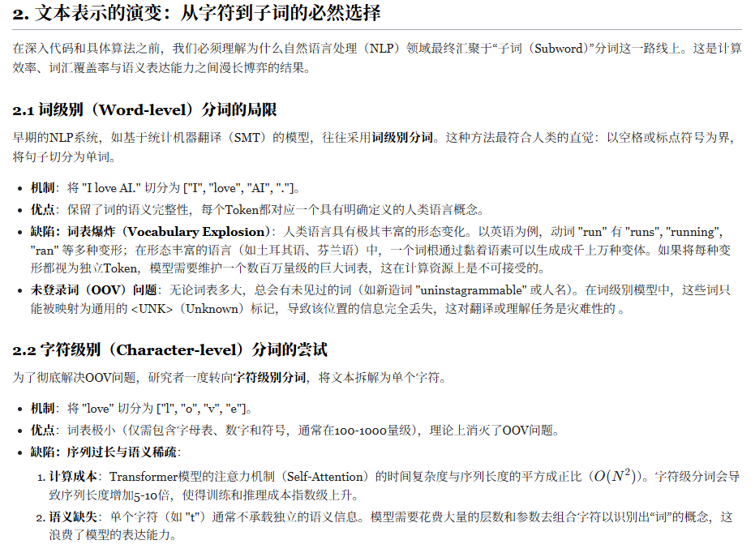

# Markdown Preview LESS 样式

这个项目用于存放 VSCode **Markdown Preview** 插件的自定义 LESS 样式。

## 样式展示

## 支持的插件

- [Markdown Preview Enhanced](https://marketplace.visualstudio.com/items?itemName=shd101wyy.markdown-preview-enhanced) - 最受欢迎的 Markdown 预览插件
- [Markdown Preview Github Styling](https://marketplace.visualstudio.com/items?itemName=bierner.markdown-preview-github-styles) - GitHub 风格的 Markdown 预览

## 使用方法

### Markdown Preview Enhanced

1. 在 VSCode 中安装 Markdown Preview Enhanced 插件
2. 打开设置（`Ctrl + ,` 或 `Cmd + ,`）
3. 搜索 `markdown-preview-enhanced`，选择全局
4. 复制.less内容即可

### Markdown Preview (VSCode 内置)

1. 打开 VSCode 设置
2. 搜索 `markdown-preview-enhanced`，选择工作区
3. 复制.less内容即可

## 文件说明

- `style.less` - 主样式文件，参考了 [Wikipedia-Theme](https://github.com/Bluemoondragon07/Wikipedia-Theme)

## 参考资料

- [Markdown Preview Enhanced 文档](https://shd101wyy.github.io/markdown-preview-enhanced/#/zh-cn/customize-css)
- [VSCode Markdown 扩展指南](https://code.visualstudio.com/docs/languages/markdown)
